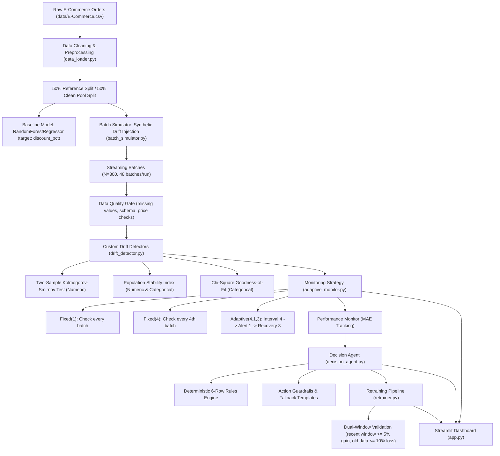

# DriftGuard: Tabular Model Monitoring Under Data Drift

DriftGuard is an end-to-end monitoring and evaluation system for tabular machine learning models operating on streaming batches. Built around a baseline discount prediction regression model for Indian e-commerce order data, DriftGuard monitors data quality, detects feature distribution drift via custom implementations of the Kolmogorov-Smirnov (KS) test and Population Stability Index (PSI), evaluates adaptive versus fixed monitoring schedules, makes operational decisions through a deterministic rules engine, and validates retraining candidates with dual-window guardrails against catastrophic forgetting.

All monitoring traces, distribution diagnostics, incident reports, and multi-seed research results are displayed in a clean, interactive Streamlit dashboard.

---

## Architecture



---

## Core Findings & Empirical Results

The research question investigated is: **Can adaptive monitoring detect distribution drift almost as fast as checking every batch while running significantly fewer checks?**

Experiments were evaluated across 30 random seeds (seeds 42 to 71) on sequences of 48 streaming batches ($N=300$).

### 1. Monitoring Strategy Comparison (Experiment B, 30 Seeds)
Source: `results/experiment_b_summary.csv`

| Scenario | Strategy | Detection Delay (Batches, Mean ± Std) | Missed Detections (Out of 30) | Full Checks Run (Mean ± Std) | Check Savings vs Fixed(1) |
| :--- | :--- | :--- | :--- | :--- | :--- |
| **Large sudden price drift** | **Fixed_1** | $1.00 \pm 0.00$ | 0 / 30 | $48.0 \pm 0.0$ | Baseline (0.0%) |
| | **Adaptive** | $1.00 \pm 0.00$ | 0 / 30 | $36.0 \pm 0.0$ | **25.0%** |
| | **Fixed_4** | $4.00 \pm 0.00$ | 0 / 30 | $12.0 \pm 0.0$ | 75.0% |
| **Medium sudden price drift** | **Fixed_1** | $2.37 \pm 1.92$ | 0 / 30 | $48.0 \pm 0.0$ | Baseline (0.0%) |
| | **Adaptive** | $4.27 \pm 4.90$ | 0 / 30 | $32.1 \pm 3.6$ | **33.1%** |
| | **Fixed_4** | $10.29 \pm 8.03$ | 2 / 30 | $12.0 \pm 0.0$ | 75.0% |
| **Medium gradual price drift** | **Fixed_1** | $7.30 \pm 2.51$ | 0 / 30 | $48.0 \pm 0.0$ | Baseline (0.0%) |
| | **Adaptive** | $13.30 \pm 5.70$ | 0 / 30 | $26.2 \pm 3.0$ | **45.4%** |
| | **Fixed_4** | $19.26 \pm 5.55$ | 3 / 30 | $12.0 \pm 0.0$ | 75.0% |
| **Small price drift** | **Fixed_1** | $13.57 \pm 8.90$ | 23 / 30 (76.7%) | $48.0 \pm 0.0$ | Baseline (0.0%) |
| | **Adaptive** | $11.33 \pm 11.68$ | 27 / 30 (90.0%) | $13.5 \pm 2.3$ | **71.9%** |
| | **Fixed_4** | $24.00 \pm 0.00$ | 29 / 30 (96.7%) | $12.0 \pm 0.0$ | 75.0% |
| **No drift (clean baseline)** | **Fixed_1** | No alert | 0 / 30 | $48.0 \pm 0.0$ | Baseline (0.0%) |
| | **Adaptive** | No alert | 0 / 30 | $12.0 \pm 0.0$ | **75.0%** |
| | **Fixed_4** | No alert | 0 / 30 | $12.0 \pm 0.0$ | 75.0% |

### Key Empirical Takeaways
1. **Trade-off on Sudden Shifts:** On large sudden price drift, Adaptive achieved identical detection delay to Fixed_1 ($1.0$ batch) while executing 25.0% fewer full checks (36 vs 48). On medium sudden drift, Adaptive added $\sim 1.9$ batches of delay ($4.27$ vs $2.37$) while saving 33.1% of checks.
2. **Gradual Drift Delay:** Under gradual drift ramping over 8 batches, Adaptive added $\sim 6$ batches of delay ($13.3$ vs $7.3$) while saving 45.4% of checks (26.2 vs 48). Fixed_4 missed 3 of 30 runs entirely and delayed detection by $19.3$ batches.
3. **Small Drift Boundary:** All strategies missed the majority of small drift runs under the default `both` rule because PSI failed to reach the $0.25$ threshold (miss rates: Fixed_1 76.7%, Adaptive 90.0%, Fixed_4 96.7%). Experiment A reveals that the Kolmogorov-Smirnov test alone (`ks_only`) detected small drift in 30 of 30 runs ($1.10$ delay), while PSI remained below threshold.
4. **False Alarms Under Clean Data:** Over 48 batches of uncorrupted data across 30 seeds, zero false alarms were observed for any monitoring strategy under the persistence rule.

---

### 2. Detector Sensitivity & False Alarms (Experiment A, 30 Seeds)
Source: `results/experiment_a_summary.csv`

Measured across 48 clean batches per seed across three batch sizes ($N=150, 300, 600$):

| Batch Size | Flag Rule | Runs with $\ge 1$ False Alarm | Total False Alarms | False Alarms per Run (Mean ± Std) |
| :--- | :--- | :--- | :--- | :--- |
| **$N = 150$** | `ks_only` | 5 / 30 | 6 | $0.2000 \pm 0.4842$ |
| | `psi_only` | 30 / 30 | 99 | $3.3000 \pm 1.6640$ |
| | `both` (default) | **0 / 30** | **0** | **0 false alarms observed in 30 runs** |
| **$N = 300$** | `ks_only` | 4 / 30 | 4 | $0.1333 \pm 0.3457$ |
| | `psi_only` | 0 / 30 | 0 | 0 false alarms observed in 30 runs |
| | `both` (default) | **0 / 30** | **0** | **0 false alarms observed in 30 runs** |
| **$N = 600$** | `ks_only` | 0 / 30 | 0 | 0 false alarms observed in 30 runs |
| | `psi_only` | 0 / 30 | 0 | 0 false alarms observed in 30 runs |
| | `both` (default) | **0 / 30** | **0** | **0 false alarms observed in 30 runs** |

*Observation:* At small batch sizes ($N=150$), quantile binning instability likely causes high false alarm rates under `psi_only` (3.3 alarms per run). Combining tests (`both`: KS p-value $< 0.01$ and PSI $\ge 0.25$) completely eliminated false alarms across all tested sample sizes.

---

### 3. Feature Ranking Precision@k (Experiment C, 30 Seeds)
Source: `results/experiment_c_summary.csv`

| Scenario | Truly Changed Features | Precision@k (Mean ± Std) | Rank 1 Accuracy (Mean ± Std) |
| :--- | :--- | :--- | :--- |
| `1feat_price_large_sudden` | `retail_price` | $1.000 \pm 0.000$ | $1.000 \pm 0.000$ |
| `1feat_price_medium_sudden` | `retail_price` | $1.000 \pm 0.000$ | $1.000 \pm 0.000$ |
| `1feat_price_medium_gradual` | `retail_price` | $1.000 \pm 0.000$ | $1.000 \pm 0.000$ |
| `1feat_region_medium_sudden` | `Region` | $1.000 \pm 0.000$ | $1.000 \pm 0.000$ |
| `1feat_rating_medium_sudden` | `product_rating` | $0.000 \pm 0.000$ | $0.000 \pm 0.000$ |
| `2feat_price_rating_medium_sudden` | `retail_price`, `product_rating` | $0.500 \pm 0.000$ | N/A ($k=2$) |
| `3feat_price_rating_region_medium_sudden` | `retail_price`, `product_rating`, `Region` | $0.667 \pm 0.000$ | N/A ($k=3$) |

*Explanation of `product_rating` precision:*
When `product_rating` is perturbed by $-0.5$ (clipped to $[1.0, 5.0]$), its PSI only reaches $0.004$ to $0.040$. High-cardinality categorical features exhibit a natural sampling noise floor under clean conditions (`product_main_category` has a mean clean PSI of $0.0955$ and max of $0.1438$ across 30 clean batches). Because raw PSI is not normalized across feature types or cardinality, `product_main_category` outranks `product_rating`, resulting in $0.000$ precision for rating drift.

---

### 4. Decision Agent Rule Evaluation (Experiment D, 30 Seeds)
Source: `results/experiment_d_summary.csv`

| Scenario | Expected Action | All-Runs Match Rate | Premise-OK Match Rate | Unnecessary Retrain Rate |
| :--- | :--- | :--- | :--- | :--- |
| `drift_perf_fine` | `INVESTIGATE` | 1.000 (30 / 30) | 1.000 (30 / 30) | 0.000 (0 / 30) |
| `drift_and_degraded` | `PROPOSE_RETRAIN` | 1.000 (30 / 30) | 1.000 (30 / 30) | 0.000 (0 / 30) |
| `perf_worse_no_drift` | `INVESTIGATE` | 1.000 (30 / 30) | 1.000 (30 / 30) | 0.000 (0 / 30) |
| `drift_labels_hidden` | `REQUEST_LABELS` | 1.000 (30 / 30) | 1.000 (30 / 30) | 0.000 (0 / 30) |

*Evaluation Scope:* In 120 of 120 runs across 30 seeds, the deterministic rules engine routed streaming inputs to the expected action. This evaluates that the pipeline components (detectors, performance monitor, rules table) operate coherently on constructed test cases. It does not measure the optimality of the actions themselves, and the optional LLM layer was not evaluated in this benchmark.

---

## Dataset & Features

- **Domain:** Indian E-Commerce Order Records
- **Source:** [mvinayak96/ecommerce-sales-analysis](https://github.com/mvinayak96/ecommerce-sales-analysis) (Great Learning DSBA course project; academic benchmarking use only; CSV is not committed per repository policy).
- **Target Variable:** `discount_pct` (numeric, bounded in $[0.0, 1.0]$).
- **Monitored Features:**
  - `retail_price` (numeric, continuous INR values)
  - `product_rating` (numeric, star ratings in $[1.0, 5.0]$)
  - `Region` (categorical, geographical zone)
  - `product_main_category` (categorical, top-level product category)
  - `BrandGroup` (categorical, top 10 brands + Other)
  - `OrderMonth` (categorical, calendar month extracted from order timestamp)

---

## Streamlit Dashboard Overview

The interactive dashboard is implemented in [`app.py`](file:///c:/Users/avksr/DRIFT_GUARD/DriftGuard/app.py) and organized into four tabs:
1. **Live simulation:** Side-by-side execution of `Fixed(1)`, `Fixed(4)`, and `Adaptive(4,1,3)` monitors across four presets (Medium sudden, Large sudden, Small, Concept shift) and Custom mode. Plots the monitoring timeline, feature PSI, and model MAE against thresholds.
2. **Investigation:** Deep-dive into specific batch detector reports, sorting features by PSI with KS/$\chi^2$ p-values and side-by-side reference vs batch distribution comparisons.
3. **Decisions and incidents:** Complete incident log with filterable tables, explicit rule-based vs LLM summary labels, retraining validation details, and export buttons for Markdown, CSV, and JSON.
4. **Experiment results:** Direct viewer for empirical artifacts produced by research scripts (`results/experiment_*.csv` and high-resolution PNG charts) with metadata manifests.

---

## Verification & Status Checklist

- [x] Phase 1: Data loader with clean reference/pool split (`src/data_loader.py`)
- [x] Phase 2: Trained baseline regression model (`src/baseline_model.py`)
- [x] Phase 3: Custom statistical drift detectors: KS test, PSI, $\chi^2$ (`src/drift_detector.py`)
- [x] Phase 4: Batch simulator with synthetic sudden and gradual drift injection (`src/batch_simulator.py`)
- [x] Phase 5: Monitoring strategies (`Fixed_1`, `Fixed_4`, `Adaptive`) and performance monitor (`src/adaptive_monitor.py`, `src/performance_monitor.py`)
- [x] Phase 6: Decision agent with rules table, LLM orchestration fallback, and guardrails (`src/decision_agent.py`)
- [x] Phase 7: Retraining pipeline with dual-window validation and catastrophic forgetting check (`src/retrainer.py`)
- [x] Phase 8: Four-tab Streamlit dashboard complying strictly with Section 8.1 UI rules (`app.py`)
- [x] Phase 9: Headless automated dashboard test suite via `streamlit.testing.v1.AppTest` (`tests/test_dashboard.py`)
- [x] Phase 10: 30-seed research experiments pipeline A, B, C, D with manifest tracking (`experiments/run_all.py`)
- [x] 77 unit, integration, AppTest, and smoke tests passing cleanly (`pytest tests/ -v`)

---

## Setup & Reproduction

### Prerequisites
- Python 3.14.6 (tested platform: Windows 64-bit; compatible with Python 3.11+)
- Git

### 1. Clone & Environment Setup
```bash
git clone https://github.com/[placeholder-author]/DriftGuard.git
cd DriftGuard

# Create and activate virtual environment
python -m venv .venv
# On Windows PowerShell:
.venv\Scripts\Activate.ps1
# On Linux/macOS:
# source .venv/bin/activate

# Install dependencies
pip install --upgrade pip
pip install -r requirements.txt
```

### 2. Download Dataset
Download the raw e-commerce CSV and place it in the `data/` directory:
```bash
# Windows PowerShell:
Invoke-WebRequest -Uri "https://raw.githubusercontent.com/mvinayak96/ecommerce-sales-analysis/main/E-Commerce.csv" -OutFile "data/E-Commerce.csv"

# Linux / macOS:
# curl -L "https://raw.githubusercontent.com/mvinayak96/ecommerce-sales-analysis/main/E-Commerce.csv" -o data/E-Commerce.csv
```

### 3. Run Test Suite
```bash
pytest tests/ -v
```

### 4. Run Research Experiments Pipeline
```bash
# Quick smoke mode (2 seeds, runs in ~15 seconds):
python experiments/run_all.py --quick

# Full research pipeline (30 seeds):
python experiments/run_all.py
```

### 5. Launch Interactive Dashboard
```bash
streamlit run app.py
```

---

## Project Structure

```
DriftGuard/
├── app.py                      # Streamlit interactive four-tab dashboard
├── config.yaml                 # Central configuration (thresholds, intervals, rules)
├── requirements.txt            # Pinned Python package dependencies
├── LICENSE                     # MIT License
├── data/
│   ├── README.md               # Dataset provenance and download instructions
│   └── .gitkeep
├── models/
│   └── .gitkeep                # Trained baseline model artifacts (excluded from git)
├── results/
│   ├── experiment_a.csv        # Sensitivity & false alarms (30 seeds, 900 rows)
│   ├── experiment_a_summary.csv
│   ├── experiment_a.png
│   ├── experiment_b.csv        # Strategy benchmark (30 seeds, 450 rows)
│   ├── experiment_b_summary.csv
│   ├── experiment_b.png
│   ├── experiment_c.csv        # Ranking precision@k (30 seeds, 210 rows)
│   ├── experiment_c_summary.csv
│   ├── experiment_c.png
│   ├── experiment_d.csv        # Decision engine evaluation (30 seeds, 120 rows)
│   ├── experiment_d_summary.csv
│   ├── experiment_d.png
│   ├── run_manifest.json       # Experiment execution metadata & git hashes
│   └── archive/                # Archived baseline outputs
├── src/
│   ├── data_loader.py          # Data ingestion, cleaning, and reference/pool splitting
│   ├── baseline_model.py       # Random forest regressor training and metric serialization
│   ├── drift_detector.py       # Custom KS test, numeric & categorical PSI, chi-square
│   ├── batch_simulator.py      # Synthetic drift injection (sudden, gradual, spread, mix)
│   ├── adaptive_monitor.py     # Monitoring strategies: Fixed_1, Fixed_4, Adaptive(4,1,3)
│   ├── performance_monitor.py  # Model error evaluation and degradation tracking
│   ├── decision_agent.py       # Deterministic rules table, LLM orchestration, guardrails
│   ├── retrainer.py            # Dual-window candidate retraining and acceptance testing
│   ├── incident_logger.py      # Incident persistence (JSON/CSV)
│   └── utils.py                # Shared config loading and git utilities
├── experiments/
│   └── run_all.py              # Master pipeline runner with CLI arguments and plotting
├── tests/
│   ├── test_data_loader.py
│   ├── test_baseline_model.py
│   ├── test_drift_detector.py
│   ├── test_batch_simulator.py
│   ├── test_adaptive_monitor.py
│   ├── test_decision_agent.py
│   ├── test_retrainer.py
│   ├── test_dashboard.py       # Headless AppTest suite testing all presets and tabs
│   └── test_smoke.py
└── docs/
    ├── METHODOLOGY.md          # Statistical, architectural, and experimental methodology
    ├── RESULTS.md              # Detailed empirical result tables and neutral interpretations
    ├── LIMITATIONS.md          # Project boundaries, statistical constraints, and dataset caveats
    ├── DEMO_SCRIPT.md          # 3-minute interview demonstration walkthrough
    └── INTERVIEW_NOTES.md      # Module design decisions and 12 technical Q&As
```

---

## Author & License

- **Author:** [Author Name]
- **License:** MIT License (see [LICENSE](LICENSE) for details).
